# code.superduper.solutions

A browser-local code editor built with Svelte and the official CodeMirror 6
packages, using the Operations repository and interface foundation. Create a
repository or import a directory, edit its files, and configure the editor in
Settings. Files, preferences, and Git remain in this browser's IndexedDB.

Each editing transaction saves immediately in private Git history; continuous
typing on one row forms one History and Undo/Redo step. Each repository has file-only undo/redo, while Global, Repository, and File
settings have independent histories. History survives reopening without replaying
tab or viewport navigation. Ordinary source commits remain explicit and independent.
No application backend is required.

The AI pane uses Pi's browser agent harness for local Ollama conversations and
[installable browser models](src/lib/assistant/browser/README.md): Bonsai 2
2B/4B/9B/27B on WebML and Ornith 1.5 9B Q4/Q8 on pinned Wllama/llama.cpp.
AI → Connections → Browser models installs weights explicitly on this device;
opening the pane does not download them.
Settings → AI configures system instructions and read-only repository tools;
the model row shows context usage and remembers each model's context budget.
Tool calls and results are visible in the conversation. Saved OpenAI connections
use the encrypted vault and remain text-only in this first tool-enabled slice.

[](.github/badges/test-scenarios.json)
[](.github/badges/test-coverage.json)

## Development status

[](https://github.com/superhero/code.superduper.solutions/actions/workflows/ci-main.yml)
[](https://github.com/superhero/code.superduper.solutions/actions/workflows/ci-develop.yml)

These badges report GitHub workflow runs when available; local checks do not
populate their status. Main handles release validation and prepared publication;
Develop validates integration changes. Publication and merges remain disabled
until the [activation prerequisites](.github/workflows/README.md#activation-and-local-development)
are met and `CODE_AUTOMATION_ENABLED=true` is explicitly set.

The scenario and coverage badges above are generated from local test evidence.
Their links expose that badge metadata; the full reports are generated at
`tmp/test-report.html` and `tmp/test-coverage.html`. Remote report hosting has
not been provisioned.

## Local development

Use Node.js **26.7.0** and npm **11.19.0**, pinned to the Operations toolchain.

```sh
npm ci
npm run dev
```

Open **http://127.0.0.1:5175**. This project has its own strict development
port; a collision fails rather than changing its origin. Vite serves the
frontend and hot updates. Add
`?dev-tools=1` for the developer toolbar; the themed error overlay operates
independently.

```sh
npm run build
npm run preview
```

Preview opens at **http://127.0.0.1:4175**, also strict. The core build contains
11 files: `dist/index.html`, embedding application code, CSS, local fonts and the
worker; `dist/_headers` for static-host isolation headers; and nine generated
[favicon files](src/assets/README.md#favicon-outputs). The original function mark
uses inline SVG with hosted ICO/PNG fallbacks and an Apple touch icon. Direct
opening of the HTML is an optional packaging check; HTTP is the standard
development workflow. The build also emits 38 optional formatter packages under
`dist/formatters/` and twelve optional language-engine packages under
`dist/languages/`, plus optional HCL/Terraform and Handlebars beta syntax packages under
`dist/syntax/`, four type-library data packages under `dist/types/`, and three
upstream SDK packages under `dist/remotes/`, downloaded only when installed from Settings.

The HTML also embeds complete project, font, vendored UI, and bundled dependency
notices in an inert `license-notices` template, inspectable in page source.
The [build packager](build/license-notices.mjs) uses Vite's bundled-package
inventory and fails when required notice text is missing.

The frontend server is not a files/Git backend. Repository content lives in
the browser. Keep the same scheme, host, and port for a stable storage origin;
development and preview have separate IndexedDB storage.

## Using the editor

- **Repositories:** create an empty repository or import a directory. The directory
  picker imports the files it supplies; if it supplies a complete `.git/`, ordinary
  Git history and refs are retained. For a submodule with a `.git` file, the editor
  asks you to select the Git directory that file points to, then imports it as a
  standalone browser repository. Relative paths start from the uploaded folder;
  enable hidden folders in the picker if needed. Without any `.git` entry, the
  import starts a new Git repository.
- **Editing:** a new import leaves files closed until you select one. Returning
  to a repository restores its tabs and active file. Reloading also restores the
  selected repository, page, cursor/selection, scrolling and expanded folders.
  Expand folders in the file tree to browse
  their contents; arrow keys move focus, and Enter or Space opens the focused file.
  Create, rename, and delete files as needed. Every accepted edit saves immediately,
  including ignored files. Continuous typing/deletion on one row shares a private
  history revision until you pause for 1.5 seconds, move the cursor, change files,
  paste, format, leave the editor, or use Undo/Redo.
  Binary/non-UTF-8 bytes are retained but cannot be edited as text.
- **History:** Undo/Redo in the editor restore only the active repository's files,
  keeping tabs, split panes and the selected view in place. Settings Undo/Redo
  affect only the selected Global, Repository, or File settings scope. Navigation
  does not become an undo step or clear another scope's redo. Cursor and selection
  remain restoration context for file changes. Histories and redo survive reload;
  editing within a scope after Undo retains its old future in private Git refs. Selecting a `Staged changes` graph entry restores that revision as an undoable
  action. Each source commit has its own saved `Staged changes` graph: new commits start
  empty, and returning to a commit restores its previous graph. Checkout restores
  committed files; select a saved change to reapply it. Repository Undo/Redo remains
  continuous across commits. Normal source branches, staging, and existing
  commits stay separate.
- **Local Git:** the editor's Commit button and both History views open the same
  review panel. Stage or unstage files and hunks, inspect staged/unstaged diffs,
  enter a message and identity, and commit the exact index while later working
  edits stay intact. Commit history selects an inspection panel; checkout is an
  explicit action. The panel also supports amend/reword, merge (including
  fast-forward and squash merge), linear rebase, squash through the branch tip,
  cherry-pick, revert, soft/mixed/hard reset, tags, branch rename/delete, and
  stash push/apply/pop/drop with optional untracked files. Conflicts have an
  editable result and explicit resolution, Continue, Skip (rebase), and Abort.
  In-progress operations survive reload. History rewrites retain recovery refs.
  Toolbar visibility and optional keybindings control entry points.
- **Upstreams:** install GitHub (Octokit), GitLab (GitBeaker) and Bitbucket Cloud
  (Bitbucket.js) in Settings, with personal token connections and optional
  passphrase-encrypted storage. Clone full repositories, browse accounts, create
  repositories/forks, fetch, track branches, pull with merge/rebase, and review
  branch/tag pushes or deletions in the Git pane's Remotes tab. Hosted requests,
  issues and checks share the same connection. GitHub Git transport requires an
  explicitly configured trusted CORS relay; no relay or backend is silently added.
  See [setup and transport requirements](src/lib/remotes/README.md).
- **Branches:** the sidebar root lists local branches and offers New branch.
  Creation selects a branch from the current commit and keeps working changes.
  Switching requires clean tracked files and staging; untracked files are kept
  unless they conflict with the target. New repositories need an initial commit
  before creating another branch.
- **Resources:** live browser memory, origin storage/quota, persistence and
  main-thread blocking measurements, with a bounded chart and read-only database
  record counts. Page memory is measured on request where supported. Monitoring
  pauses outside the view or when the page is hidden; samples are not persisted
  or sent anywhere. Unsupported values stay unavailable.
- **Settings:** personal defaults, repository overrides, and selected-file overrides
  apply live. Theme, typography, indentation, wrapping, gutters, editing aids,
  completion and filename-to-language suffix mappings are configurable.
  Syntax highlighting supports 148 included local language modes, automatic filename
  detection, personal/repository suffix mappings, and fenced code in Markdown. Handlebars uses the
  stable parser by default, with a separately installed Gentrace beta alternative. Each theme has twelve
  color slots: six interface colors and six syntax accents with light/dark variants.
  Common `.editorconfig` glob sections, nested roots and `unset` apply indentation
  and tab width between repository settings and explicit file overrides. Other
  EditorConfig properties do not automatically transform imported files. File
  overrides belong to their paths; renaming a file does not move its overrides.

Keyboard Undo/Redo and the toolbar use the same application history. Tab normally
indents code; press Escape then Tab to leave the editor. Settings can instead make
Tab move keyboard focus.
Use the **Format document** icon in the second header for manual local formatting.
Install the desired providers in **Settings → Global defaults → Formatters**.
Packages are stored in IndexedDB and work offline after installation; Settings
also provides explicit updates, removal, export/import and license notices.
Choose the formatter per language in **Formatter preferences**, with personal
defaults and repository overrides. Installation never changes this selection.
Recommendations prefer official integrations, with optional on-device comparisons
showing first-use and subsequent formatting times. Comparisons never edit files.
dprint and Prettier run locally in an embedded worker, following the documented
[language mapping and configuration rules](src/lib/formatting/README.md).
Formatting is one undoable change; autosave and Ctrl+S do not format.

**Language engines** are separately opt-in. Install reviewed packages in
**Settings → Global defaults → Language engine packages**, then activate each
language under **Language engines**, personally or for one repository. All start
disabled. Twelve local worker packages support JavaScript/TypeScript, HTML,
CSS/SCSS/Less, JSON/JSONC, YAML, Markdown, GraphQL, Dockerfile, PostgreSQL SQL, TOML, WGSL and Shopify Liquid, providing completion,
hover and diagnostics where supported. Installed packages work offline and support
export/import, updates, removal and full license notices. Dependencies and schemas
are read locally; nothing is fetched automatically. Python engines are excluded
from this pass. See [capabilities and limits](src/lib/intelligence/README.md).

Git and filesystem operations run in an embedded worker. Saves are acknowledged
only after durable writes; interrupted journaled operations recover on reopening.
Conflicting writes from another tab are rejected while keeping the visible text
available to download. Wait for **All changes saved** before leaving the page.
Browser storage still depends on the browser's quota and eviction policies.

Remote Git uses complete HTTPS clones with all advertised branches, tags and
reachable history. Direct transport requires the host to allow browser Git CORS;
otherwise configure a trusted relay in the connection. Account credentials and
deployed CORS/relay permissions need user configuration. Real upstream writes are
not exercised by the implementation tests. SSH, LFS object transfers and Bitbucket
Data Center are not included. Repository export remains future work.

See the [history decision](docs/adr/editor-history.md) and
[repository service guide](src/lib/repository/README.md) for the storage contract.

## Validation and commands

Bash, Git, and jq are required for automation checks. Browser tests normally
use Docker and the Playwright image matching the pinned package. The
[test guide](tests/README.md) documents its explicit local-browser alternative
and diagnostic output.

```sh
npm run check
```

This performs type checking, all four Cucumber profiles, scoped coverage,
production build, combined reports, and generated-badge consistency checks.
Reports open offline from `tmp/test-report.html` and `tmp/test-coverage.html`.
Both retain full license notices in their page source. The test report keeps
result tables, filtering, attachments and navigation; its optional graphical
charts are omitted. See the [report asset inventory](.github/licenses/README.md).
Coverage is 100% of the explicitly scoped Node-executable application logic;
it is not a whole-interface coverage claim.

| Command | Purpose |
| --- | --- |
| `npm ci` | Install exact locked dependencies. |
| `npm run dev` / `npm run preview` | Serve development / the built artifact. |
| `npm run typecheck` / `npm run build` | Check Svelte/TypeScript / check favicon freshness and package production assets. |
| `npm run icons:generate` / `npm run icons:check` | Regenerate favicon derivatives / verify they match the canonical SVG without writing. |
| `npm test` | Source with coverage, coverage gate, build, acceptance, automation, and browser suites. |
| `npm run test:source` | Cucumber application-source behavior. |
| `npm run test:source:coverage` | Source scenarios with c8 collection. |
| `npm run test:coverage` | Report and enforce scoped coverage from fresh collection. |
| `npm run test:acceptance` | Built-artifact acceptance; build first. |
| `npm run test:acceptance:coverage` | Acceptance with c8 collection. |
| `npm run test:automation` | Repository workflow and helper behavior. |
| `npm run test:browser` | Cucumber scenarios driven by Playwright; build first. |
| `npm run report:tests` | Combine fresh results from all four profiles. |
| `npm run report:coverage` | Package the fresh coverage report as standalone HTML. |
| `npm run badges:dependencies` | Regenerate dependency-version badges. |
| `npm run badges:scenarios` | Regenerate badges from all four scenario reports. |
| `npm run badges:coverage` | Regenerate the scoped-coverage badge. |
| `npm run check` | Run the complete local validation and report/badge contract. |

Regenerate affected badges after source/dependency/test changes, then check
that they match the final evidence. Filtered or stale suite output does not
establish complete reporting. See the [automation guide](.github/workflows/README.md)
for the full command ordering and release procedures.

## Repository foundation

- [Application source](src/README.md): Svelte composition, strict TypeScript,
  semantic themes, owned Button/Sheet primitives, and licensed local fonts.
- [Build adapters](build/README.md): generated favicon compatibility files,
  inline runtime assets, and preserved license notices.
- [Development adapters](src/dev/README.md): Pail diagnostics, Visulima cause
  navigation, themed overlay, and opt-in performance/timeline toolbar.
- [Tests](tests/README.md): source, acceptance, automation, and browser profiles,
  combined Cucumber reports, Playwright, and c8.
- [Repository automation](.github/DIRECTORY.md): Gitflow branch policy,
  changelog/release preparation, merges, previews, artifact promotion, report
  publication, synchronization, and scheduled dependency status.
- [Architectural decisions](CONTRIBUTING.md#architectural-decision-records)
  and [foundation audit](docs/foundation-parity.md): adapted contracts, source
  evidence, product exclusions, and external provisioning still required.

The complete automation is prepared locally. Remote mutation is **disabled
unless `CODE_AUTOMATION_ENABLED` equals `true`**. GitHub App permissions,
protected branches, secrets, Cloudflare resources, and domains still require
separate provisioning and authorization. No release, deployment, or remote
configuration is implied by these files; this work remains local without a push.

## Editor architecture

Each repository has a directory in the IndexedDB-backed LightningFS filesystem
containing its working tree and ordinary `.git/` history. A separate private Git
directory records editing changes. A separate application Git timeline orders
workspace/settings snapshots and references the exact repository revisions for
file changes. Workspace-only actions do not create repository file snapshots.
The worker runs isomorphic-git locally; metadata and editor settings stay separate
from source files and ordinary commits.

Cloning preserves **full history, branches, and tags**. A ZIP archive, shallow
clone or single-branch shortcut does not satisfy that contract. The explicit
direct/relay transport and credential boundary are documented in the
[upstream decision](docs/adr/upstream-integrations.md).

## Dependency versions

These badges show the exact versions declared in this revision. Registry status
refresh is a separate scheduled automation operation, disabled by default.

<a href="https://www.npmjs.com/package/@octokit/rest"></a>
<a href="https://www.npmjs.com/package/@gitbeaker/rest"></a>
<a href="https://www.npmjs.com/package/bitbucket">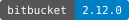</a>

<a href="https://www.npmjs.com/package/@cucumber/cucumber"></a>
<a href="https://www.npmjs.com/package/@playwright/test"></a>
<a href="https://www.npmjs.com/package/@sveltejs/vite-plugin-svelte"></a>
<a href="https://www.npmjs.com/package/@tailwindcss/vite"></a>
<a href="https://www.npmjs.com/package/@visulima/dev-toolbar"></a>
<a href="https://www.npmjs.com/package/@visulima/inspector"></a>
<a href="https://www.npmjs.com/package/@visulima/pail"></a>
<a href="https://www.npmjs.com/package/@visulima/vite-overlay"></a>
<a href="https://www.npmjs.com/package/bits-ui">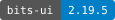</a>
<a href="https://www.npmjs.com/package/c8">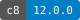</a>
<a href="https://www.npmjs.com/package/cn"></a>
<a href="https://www.npmjs.com/package/multiple-cucumber-html-reporter"></a>
<a href="https://www.npmjs.com/package/rolldown"></a>
<a href="https://www.npmjs.com/package/sharp"></a>
<a href="https://www.npmjs.com/package/svelte"></a>
<a href="https://www.npmjs.com/package/svelte-check"></a>
<a href="https://www.npmjs.com/package/tailwind-variants"></a>
<a href="https://www.npmjs.com/package/tailwindcss"></a>
<a href="https://www.npmjs.com/package/tw-animate-css"></a>
<a href="https://www.npmjs.com/package/typescript"></a>

TypeScript 6 remains pinned with the Operations toolchain. Before a TypeScript 7
upgrade, review the [Svelte language-tools compatibility issue](https://github.com/sveltejs/language-tools/issues/3063).

[](https://github.com/sveltejs/language-tools/issues/3063)

<a href="https://www.npmjs.com/package/vite">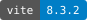</a>
<a href="https://www.npmjs.com/package/vite-plugin-singlefile"></a>
<a href="https://www.npmjs.com/package/yaml"></a>

<a href="https://www.npmjs.com/package/@codemirror/autocomplete"></a>
<a href="https://www.npmjs.com/package/@codemirror/commands"></a>
<a href="https://www.npmjs.com/package/@codemirror/lang-css"></a>
<a href="https://www.npmjs.com/package/@codemirror/lang-html"></a>
<a href="https://www.npmjs.com/package/@codemirror/lang-javascript"></a>
<a href="https://www.npmjs.com/package/@codemirror/lang-json"></a>
<a href="https://www.npmjs.com/package/@codemirror/lang-markdown"></a>
<a href="https://www.npmjs.com/package/@codemirror/language"></a>
<a href="https://www.npmjs.com/package/@codemirror/language-data"></a>
<a href="https://www.npmjs.com/package/@codemirror/search"></a>
<a href="https://www.npmjs.com/package/@codemirror/state"></a>
<a href="https://www.npmjs.com/package/@codemirror/view"></a>
<a href="https://www.npmjs.com/package/@isomorphic-git/lightning-fs"></a>
<a href="https://www.npmjs.com/package/@lezer/highlight"></a>
<a href="https://www.npmjs.com/package/@lezer/javascript"></a>
<a href="https://www.npmjs.com/package/@replit/codemirror-lang-svelte"></a>
<a href="https://www.npmjs.com/package/buffer"></a>
<a href="https://www.npmjs.com/package/idb"></a>
<a href="https://www.npmjs.com/package/isomorphic-git">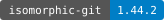</a>
<a href="https://www.npmjs.com/package/@lezer/markdown"></a>
<a href="https://www.npmjs.com/package/@mathjax/mathjax-tex-font"></a>
<a href="https://www.npmjs.com/package/@mathjax/src"></a>
<a href="https://www.npmjs.com/package/markdown-it"></a>
<a href="https://www.npmjs.com/package/@earendil-works/pi-agent-core"></a>
<a href="https://www.npmjs.com/package/@earendil-works/pi-ai"></a>
<a href="https://www.npmjs.com/package/typebox"></a>
<a href="https://www.npmjs.com/package/@mdit/plugin-abbr"></a>
<a href="https://www.npmjs.com/package/@mdit/plugin-advanced-links"></a>
<a href="https://www.npmjs.com/package/@mdit/plugin-alert"></a>
<a href="https://www.npmjs.com/package/@mdit/plugin-align"></a>
<a href="https://www.npmjs.com/package/@mdit/plugin-anchor"></a>
<a href="https://www.npmjs.com/package/@mdit/plugin-attrs"></a>
<a href="https://www.npmjs.com/package/@mdit/plugin-container"></a>
<a href="https://www.npmjs.com/package/@mdit/plugin-demo"></a>
<a href="https://www.npmjs.com/package/@mdit/plugin-dl"></a>
<a href="https://www.npmjs.com/package/@mdit/plugin-embed"></a>
<a href="https://www.npmjs.com/package/@mdit/plugin-emoji"></a>
<a href="https://www.npmjs.com/package/@mdit/plugin-field"></a>
<a href="https://www.npmjs.com/package/@mdit/plugin-figure"></a>
<a href="https://www.npmjs.com/package/@mdit/plugin-footnote"></a>
<a href="https://www.npmjs.com/package/@mdit/plugin-icon"></a>
<a href="https://www.npmjs.com/package/@mdit/plugin-img-lazyload"></a>
<a href="https://www.npmjs.com/package/@mdit/plugin-img-mark"></a>
<a href="https://www.npmjs.com/package/@mdit/plugin-img-size"></a>
<a href="https://www.npmjs.com/package/@mdit/plugin-include"></a>
<a href="https://www.npmjs.com/package/@mdit/plugin-inline-rule"></a>
<a href="https://www.npmjs.com/package/@mdit/plugin-ins"></a>
<a href="https://www.npmjs.com/package/@mdit/plugin-katex"></a>
<a href="https://www.npmjs.com/package/@mdit/plugin-katex-slim"></a>
<a href="https://www.npmjs.com/package/@mdit/plugin-layout"></a>
<a href="https://www.npmjs.com/package/@mdit/plugin-mark"></a>
<a href="https://www.npmjs.com/package/@mdit/plugin-mathjax"></a>
<a href="https://www.npmjs.com/package/@mdit/plugin-mathjax-slim"></a>
<a href="https://www.npmjs.com/package/@mdit/plugin-plantuml"></a>
<a href="https://www.npmjs.com/package/@mdit/plugin-ruby"></a>
<a href="https://www.npmjs.com/package/@mdit/plugin-snippet"></a>
<a href="https://www.npmjs.com/package/@mdit/plugin-spoiler"></a>
<a href="https://www.npmjs.com/package/@mdit/plugin-stylize"></a>
<a href="https://www.npmjs.com/package/@mdit/plugin-sub"></a>
<a href="https://www.npmjs.com/package/@mdit/plugin-sup"></a>
<a href="https://www.npmjs.com/package/@mdit/plugin-tab"></a>
<a href="https://www.npmjs.com/package/@mdit/plugin-tasklist"></a>
<a href="https://www.npmjs.com/package/@mdit/plugin-tex"></a>
<a href="https://www.npmjs.com/package/@mdit/plugin-uml"></a>
<a href="https://www.npmjs.com/package/katex"></a>

<a href="https://www.npmjs.com/package/minimatch"></a>

<a href="https://www.npmjs.com/package/@bjorn3/browser_wasi_shim"></a>
<a href="https://www.npmjs.com/package/@codemirror/lint"></a>
<a href="https://www.npmjs.com/package/@codemirror/merge"></a>
<a href="https://www.npmjs.com/package/@dprint/dockerfile"></a>
<a href="https://www.npmjs.com/package/@dprint/formatter"></a>
<a href="https://www.npmjs.com/package/@dprint/json"></a>
<a href="https://www.npmjs.com/package/@dprint/jupyter"></a>
<a href="https://www.npmjs.com/package/@dprint/mago"></a>
<a href="https://www.npmjs.com/package/@dprint/markdown"></a>
<a href="https://www.npmjs.com/package/@dprint/roslyn"></a>
<a href="https://www.npmjs.com/package/@dprint/ruff"></a>
<a href="https://www.npmjs.com/package/@dprint/toml"></a>
<a href="https://www.npmjs.com/package/@dprint/typescript"></a>
<a href="https://www.npmjs.com/package/@gentrace/codemirror-lang-handlebars"></a>
<a href="https://www.npmjs.com/package/@iizukak/codemirror-lang-wgsl"></a>
<a href="https://www.npmjs.com/package/@jakebailey/dprint-plugin-gofumpt"></a>
<a href="https://www.npmjs.com/package/@kachick/dprint-plugin-kdl"></a>
<a href="https://www.npmjs.com/package/@kachick/dprint-plugin-nix"></a>
<a href="https://www.npmjs.com/package/@kachick/dprint-plugin-sh"></a>
<a href="https://www.npmjs.com/package/@kachick/dprint-plugin-typstyle"></a>
<a href="https://www.npmjs.com/package/@lezer/common"></a>
<a href="https://www.npmjs.com/package/@lezer/lr"></a>
<a href="https://www.npmjs.com/package/@postgres-language-server/wasm"></a>
<a href="https://www.npmjs.com/package/@prettier/plugin-xml"></a>
<a href="https://www.npmjs.com/package/@shopify/theme-language-server-browser"></a>
<a href="https://www.npmjs.com/package/@taplo/lsp"></a>
<a href="https://www.npmjs.com/package/@types/node"></a>
<a href="https://www.npmjs.com/package/@types/semver"></a>
<a href="https://www.npmjs.com/package/@xiechao/codemirror-lang-handlebars"></a>
<a href="https://www.npmjs.com/package/cm6-graphql"></a>
<a href="https://www.npmjs.com/package/codemirror-lang-hcl"></a>
<a href="https://www.npmjs.com/package/codemirror-lang-makefile"></a>
<a href="https://www.npmjs.com/package/diff3">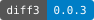</a>
<a href="https://www.npmjs.com/package/dockerfile-language-service"></a>
<a href="https://www.npmjs.com/package/dprint-plugin-graphql">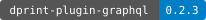</a>
<a href="https://www.npmjs.com/package/dprint-plugin-malva">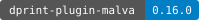</a>
<a href="https://www.npmjs.com/package/dprint-plugin-markup">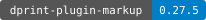</a>
<a href="https://www.npmjs.com/package/dprint-plugin-yaml"></a>
<a href="https://www.npmjs.com/package/github-slugger">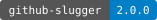</a>
<a href="https://www.npmjs.com/package/graphql"></a>
<a href="https://www.npmjs.com/package/graphql-language-service"></a>
<a href="https://www.npmjs.com/package/hash-wasm"></a>
<a href="https://www.npmjs.com/package/ignore">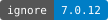</a>
<a href="https://www.npmjs.com/package/jsonc-parser"></a>
<a href="https://www.npmjs.com/package/lax-css"></a>
<a href="https://www.npmjs.com/package/lax-markup"></a>
<a href="https://www.npmjs.com/package/lax-sql"></a>
<a href="https://www.npmjs.com/package/node-html-parser"></a>
<a href="https://www.npmjs.com/package/path-browserify"></a>
<a href="https://www.npmjs.com/package/prettier"></a>
<a href="https://www.npmjs.com/package/prettier-plugin-svelte"></a>
<a href="https://www.npmjs.com/package/semver"></a>
<a href="https://www.npmjs.com/package/vscode-css-languageservice"></a>
<a href="https://www.npmjs.com/package/vscode-html-languageservice"></a>
<a href="https://www.npmjs.com/package/vscode-json-languageservice"></a>
<a href="https://www.npmjs.com/package/vscode-languageserver-protocol"></a>
<a href="https://www.npmjs.com/package/vscode-languageserver-textdocument"></a>
<a href="https://www.npmjs.com/package/vscode-languageserver-types"></a>
<a href="https://www.npmjs.com/package/vscode-markdown-languageservice"></a>
<a href="https://www.npmjs.com/package/vscode-uri"></a>
<a href="https://www.npmjs.com/package/wgslender-lsp"></a>
<a href="https://www.npmjs.com/package/yaml-language-server"></a>

## Contribution and license

Start with [CONTRIBUTING](CONTRIBUTING.md) and the [Code of Conduct](CODE_OF_CONDUCT.md).
First-party material uses [AGPL-3.0-only](LICENSE) with applicable
[Section 7 additional terms](LICENSE-ADDITIONAL-TERMS). Bundled assets and the
Code of Conduct retain their own notices. [CITATION.cff](CITATION.cff) describes
this pre-release project; [CHANGELOG.md](CHANGELOG.md) holds unreleased work.
